# skillmap

Which skills do employers actually ask for, how is that changing, and how does it differ by
seniority, location, role and sector? `skillmap` answers that from job postings, collected
every day, and publishes the result to
[pierreblachere.com/skills](https://www.pierreblachere.com/skills).



The heatmap above regenerates every night: each cell is the share of current tech postings
in that role family that ask for the skill, and the last column is my own rating.

## How it works

```
 company boards ─┐
 (Greenhouse,    │
  Lever, Ashby,  │    normalise                 Supabase Postgres           aggregate
  Workable)      ├──▶ skills · seniority ──▶   postings (full text,  ──▶  data/skills-market.json ──▶ website
 Adzuna API      │    role · location          first/last seen)           data/skills-heatmap.svg ──▶ this README
 MyCareersFuture │    sector · salary                                     release: postings-live.jsonl.gz
 HN "Who is      │
  hiring?"      ─┘
                         GitHub Actions, daily at 02:00 Singapore time
```

- **Collect** (`skillmap/sources/`). One module per source, each turning that source's JSON
  into a common `RawPosting`. A shared HTTP client identifies itself, rate-limits per host and
  retries transient errors. A source that fails is recorded in the run summary and the rest of
  the run carries on.
- **Extract** (`skillmap/extract/`). A taxonomy of 90 skills (`config/taxonomy.yaml`), each a
  set of regexes written for full posting text: word boundaries, case-sensitive patterns for
  ambiguous names like *Go* and *MCP*, and context rules so "go beyond" is not Go. Lines under
  a "Nice to have" heading (or saying "is a plus") are tracked separately from requirements.
  Seniority comes from the title, then from stated years of experience, then from the
  source's own level. Role family comes from the title; location is normalised to country,
  city and region.
- **Store** (`skillmap/store.py`). Every posting is stored once, with the day it was first
  and last seen, so "live in a given month" is well defined. The full text is kept in the
  database so extraction can be re-run: bumping the taxonomy `version` re-extracts every
  stored posting on the next run. The text itself is never published.
- **Aggregate** (`skillmap/aggregate.py`). Pure functions from stored rows to one JSON file:
  skill shares over the last 30 days with change against the 30 days before, monthly trends,
  breakdowns by seniority, role family, region, country and sector over 90 days, which skills
  appear together, and advertised Singapore salaries by skill. The same ad found on several
  sources is counted once. A group with fewer than 30 postings is reported with its size but no
  percentages.

## Sources

Only sources that publish postings for programmatic reading are used:

| Source | What it adds | Access |
|---|---|---|
| Greenhouse, Lever, Ashby, Workable | Full postings from the ~35 companies in `config/companies.yaml` (AI labs, crypto, fintech) | Public job-board APIs that the companies publish themselves |
| [Adzuna](https://developer.adzuna.com/) | Broad market in Singapore, the UK and the US | Free API key; "Job data: The Adzuna API". Descriptions are snippets, so its skill counts are a lower bound |
| MyCareersFuture | Singapore's national job portal, including advertised salary ranges | The search API its own site uses, read slowly (one request every 3 s), newest first, stopping at postings already collected |
| Hacker News "Who is hiring?" | Monthly threads back to 2011: the long trend lines | Official [HN Algolia API](https://hn.algolia.com/api) |

LinkedIn, Indeed and Glassdoor forbid scraping in their terms and are not used.

## Running it

```sh
uv sync
uv run pytest                                  # unit + end-to-end tests (no network)
uv run skillmap run --sources hn --hn-since 2026-10-01 --out /tmp/out   # in-memory store
DATABASE_URL=postgresql://… uv run skillmap run                         # the real thing
```

Repository secrets used by `.github/workflows/refresh.yml`:

| Secret | Required | Where it comes from |
|---|---|---|
| `DATABASE_URL` | yes | Supabase → Connect → Session pooler URI |
| `ADZUNA_APP_ID`, `ADZUNA_APP_KEY` | no (Adzuna is skipped without them) | developer.adzuna.com |

The first run backfills every HN thread since 2011 and the last 60 days of MyCareersFuture;
later runs only fetch what is new. The refresh workflow can also be started by hand with a
subset of sources or a board limit, for smoke tests.

Tests that need Postgres run when `SKILLMAP_TEST_DATABASE_URL` is set; CI provides one.

## Known limits

- Company boards are a curated list, so the "market" view leans towards the employers in
  `config/companies.yaml`; Adzuna and MyCareersFuture widen it for Singapore.
- HN posters are mostly startups and skew remote and US. That series is shown separately and
  never mixed with the live market numbers.
- Regex extraction misses phrasing it has no pattern for. The tests pin both what it must find
  and the false positives it must avoid; new cases go in `tests/test_extract.py`.
